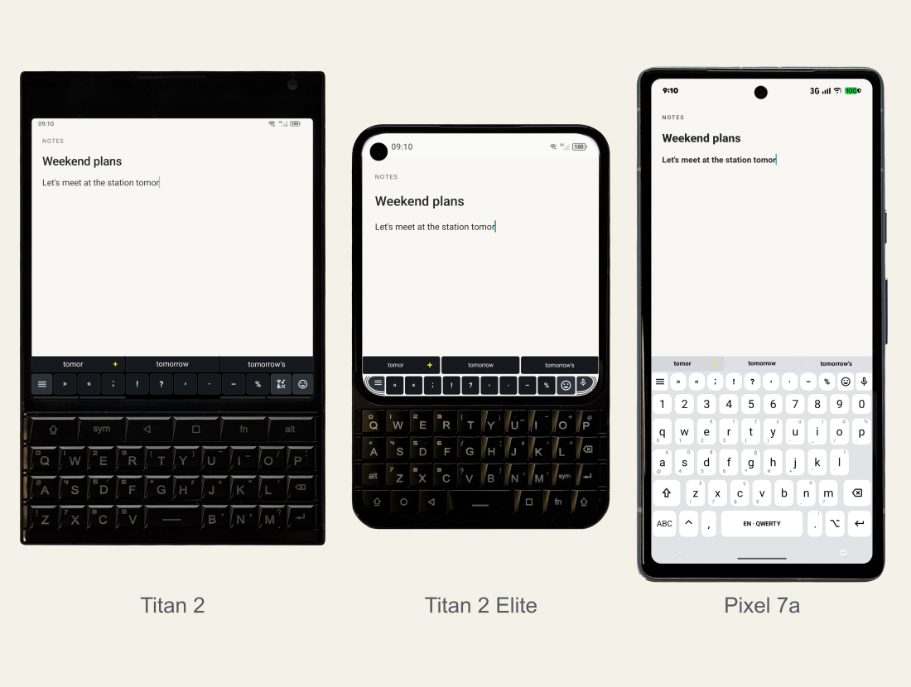
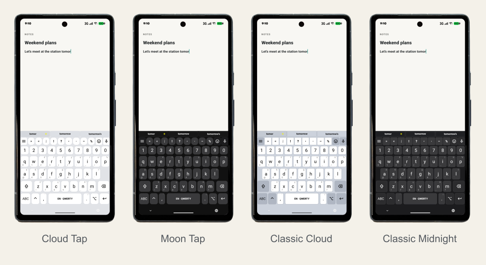

<p align="center"></p>

# Plektra

**Advanced (hardware) keyboard control on Android**

Free software under [GPLv3](LICENSE), with source code you can inspect, modify and share.

Plektra grew out of Pastiera, created by Andrea Palumbo (PalSoftware). Patrick Zauner took over maintenance of Pastiera and later continued the project as Plektra.

[Product page](https://pkb.rocks/) · [Releases](https://github.com/pkb-rocks/plektra/releases) · [Installation guide](docs/getting-started.md)

<a href="https://opencollective.com/plektra"></a>

## Special thanks to Clicks Technology

We thank [Clicks Technology](https://clicks.tech) for their foundational support. Their support enables us to bring Plektra to more devices and sustain its development over the long term.

Our ambition is to make Plektra **the** keyboard app for power users.

## Contents

[Highlights](#highlights) · [Keys and bar](#keys-and-bar) · [Text and tools](#text-and-tools) · [Look and layout](#look-and-layout) · [Download and install](#download-and-install) · [Devices](#devices) · [Build and contribute](#build-and-contribute)

## Highlights

| Feature | Controls and tools |
| --- | --- |
| [Customizable Toolbar](#modular-toolbar-configuration) | Suggestions, character variations and menu buttons; separate Normal and Slim profiles; shared or stacked rows |
| [Hardware Key Remapping](#keys-and-bar) | Physical layouts, modifiers, SYM pages, navigation shortcuts, app shortcuts and command mappings |
| [Smart Text Suggestions](#predictive-text-and-completions) | Dictionaries, word completions, autocorrection and locally learned next words |
| [Snippets & Clipboard](#expandable-text-snippets--templates) | Text expansion from a short prefix, reusable snippets and clipboard history |
| [Themes & Layouts](#nine-built-in-interface-themes) | Nine keyboard bar themes, high contrast, QWERTY, AZERTY and QWERTZ, plus importable layouts |



## Keys and bar

### Modular toolbar configuration

Configure suggestions, character variations and menu buttons independently.


### Adjustable interface density

Choose a full bar, compact controls, a modifier LED strip or a hidden bar.


### Dual profiles: Normal and Slim

Configure Normal and Slim independently, then switch between the two profiles.


### Flexible toolbar layouts

Place suggestions and actions in a shared row or arrange them in stacked rows.


### Live modifier state indicators

See active and locked modifiers in the keyboard bar or Android status bar.


### Ortholinear and staggered key geometries

Choose ortholinear or staggered rows for the software keyboard.


## Text and tools

### Predictive text and completions

Complete words from suggestions as you type. Dictionaries and locally learned next words are supported.


### Contextual character variations

Select accented letters and symbols from the variations for the current character.


### Long-press secondary characters

Long-press a software key to select its secondary characters.


### Expandable text snippets & templates

Save reusable text such as addresses, email addresses and dates. Find snippets with a short prefix.


### Text shortcut expansion

Expand a snippet shortcut into its saved text.


### Direct SYM layer mapping

Open SYM pages and enter symbols using the corresponding physical keys.


### Integrated, low-profile emoji picker

Browse and insert emoji from the keyboard.


### Integrated clipboard manager

Browse clipboard history and insert a saved entry.


### Keyboard text selection

Select text using physical keyboard controls.


### Terminal-style Ctrl navigation and selection

Use Ctrl shortcuts to move the cursor, select text, copy and paste.


## Look and layout

### Nine built-in interface themes

Choose from nine built-in keyboard bar themes.


### Standalone software keyboard mode

Use the software keyboard on phones without physical keys, with suggestions, symbols and snippets.



### Native QWERTY, AZERTY, and QWERTZ support

Select QWERTY, AZERTY or QWERTZ, including German umlauts.


### High-contrast mode for improved visibility

Use a high-contrast theme with clear key outlines and distinct modifier indicators.


Explore the complete [21-image device showcase](docs/showcase/README.md), with Stable and Nightly galleries. See [Features](docs/features.md) for voice input, local notes, backup and accessibility options.

## Download and install

| Channel | Purpose | Download |
| --- | --- | --- |
| Plektra Stable | Release for everyday use | [Stable releases](https://github.com/pkb-rocks/plektra/releases/latest) |
| Plektra Nightly | Development builds with the newest features; can contain bugs and incomplete features | [Nightly releases](https://github.com/pkb-rocks/plektra/releases) |

The first Stable release is planned for **26.10**. Until then, Nightly is the newest build. Versions use CalVer: `26.10` means October 2026; `26.10-nightly.DD.HHmmssZ` adds the UTC build day and time. APKs, release notes and checksums are available on GitHub Releases.

Stable and Nightly are separate apps with their own settings. Install both and select the active keyboard in Android’s keyboard settings. Use Stable as your everyday keyboard and switch to Nightly to try new features; switch back to Stable if a Nightly build gets in your way.

The full APK includes the Clicks accessibility service for launcher-button remapping. The APK without that service retains every other keyboard feature, including TalkBack support. The two variants replace each other within the same channel.

Download the `-full.apk` or `-no-accessibility.apk` asset from the selected [GitHub release](https://github.com/pkb-rocks/plektra/releases). Its release notes and `SHA256SUMS` are listed on the same page.

Additional distribution channels:

- [Our F-Droid Nightly repository](https://pkb.rocks/fdroid/nightly/repo) — Available soon
- [F-Droid main repository](https://f-droid.org/packages/rocks.pkb.plektra/) — Available soon
- [Google Play](https://play.google.com/store/apps/details?id=rocks.pkb.plektra.unsovereign) — Available soon
- [Add to Obtainium](https://apps.obtainium.imranr.dev/redirect?r=obtainium://app/%7B%22id%22%3A%22rocks.pkb.plektra.nightly%22%2C%22url%22%3A%22https%3A%2F%2Fgithub.com%2Fpkb-rocks%2Fplektra%2Freleases%22%2C%22author%22%3A%22pkb-rocks%22%2C%22name%22%3A%22Plektra%20Nightly%22%2C%22additionalSettings%22%3A%22%7B%5C%22includePrereleases%5C%22%3Atrue%2C%5C%22filterReleaseTitlesByRegEx%5C%22%3A%5C%22nightly%5C%22%2C%5C%22apkFilterRegEx%5C%22%3A%5C%22-full%5C%5C%5C%5C.apk%24%5C%22%7D%22%7D) — Nightly updates from GitHub releases

The canonical Stable and Nightly APKs use separate published hardware-backed signing keys. Planned Google Play variants use separate app identities. See [Getting started](docs/getting-started.md) and [all releases](https://github.com/pkb-rocks/plektra/releases).

## Devices

| Device | Support |
| --- | --- |
| Unihertz Titan 2 | Developed and release-tested; device-specific physical keyboard layouts and display geometry |
| Unihertz Titan 2 Elite | Developed and release-tested; device-specific physical keyboard layouts and display geometry |
| Google Pixel 7a + Clicks Power Keyboard | Directly tested physical keyboard combination |
| Samsung Galaxy Z Fold6 | Directly tested software keyboard and folding behaviour; also used with Clicks Power Keyboard |

Community-supported devices include the BlackBerry KEY2, Minimal Phone MP01 and BlackBerry Q25 (Zinwa mod), alongside other Clicks keyboard models. These are a selection of tested devices; further improvements for foldables are planned. See the [device support ranking](docs/devices.md) and [hardware notes](docs/device-support/).

## Moving from Pastiera

Import a Pastiera backup ZIP in Plektra’s Advanced settings. Plektra keeps its own app identity. An assisted migration flow is planned before the first Stable release. See [Migration from Pastiera](docs/migration-from-pastiera.md).

## Build and contribute

Build a Nightly debug APK with JDK 17 and the Android SDK for compile SDK 36:

```sh
git clone https://github.com/pkb-rocks/plektra.git
cd plektra
scripts/build-nightly-debug.sh 26.10
```

To build and install on a connected device, add `--install --device <serial>`. Project structure and checks are in [Development](docs/development.md); maintainers use [Releasing](docs/releasing.md).

For debug builds, copy `.env.example` to `.env`, run `chmod 600 .env`, and enter the speech API keys you use. Both `.env` and backups in `.local-work/device-backups/` are gitignored and contain private data. Build, back up the installed debug app, and install the update with:

```sh
scripts/build-nightly-debug.sh 26.10 --install --backup --device <serial> --env .env
```

For an explicit uninstall and reinstall, replace `--backup` with `--reinstall`. This includes a backup of the APK and app data, then restores app data, runtime permissions and keyboard selection. Android Keystore keys do not survive uninstalling: supply replacement keys in `.env` for every speech provider stored in the backup. Missing replacement keys prevent uninstallation. Use this path when replacing a debug build signed with a different key.

To import keys without reinstalling, or back up and restore a debuggable app separately:

```sh
python3 scripts/setup-speech.py --device <serial> --env .env
python3 scripts/debug_device.py --device <serial> backup
python3 scripts/debug_device.py --device <serial> --env .env restore <backup-directory>
```

Restore requires the same package on the same device with a debuggable APK installed. Only supplied keys and optional speech settings are changed by the key import; omitted settings remain unchanged.

Distributed forks must use their own name, application ID, update endpoints and branding, and must not present themselves as official Plektra releases.

## Project links

- [Product page](https://pkb.rocks/)
- [GitHub](https://github.com/pkb-rocks/plektra)
- [Open Collective](https://opencollective.com/plektra)
- [Security policy](SECURITY.md)
- [Imprint](https://pzauner.de/Notes/.hidden/Impressum.pdf)
