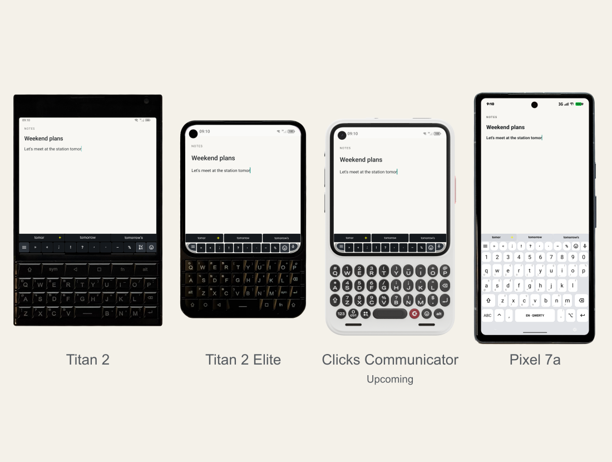
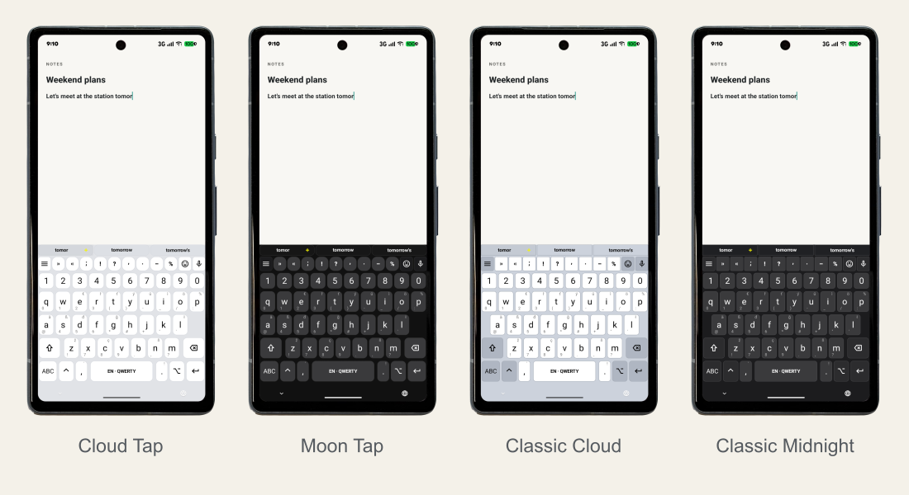
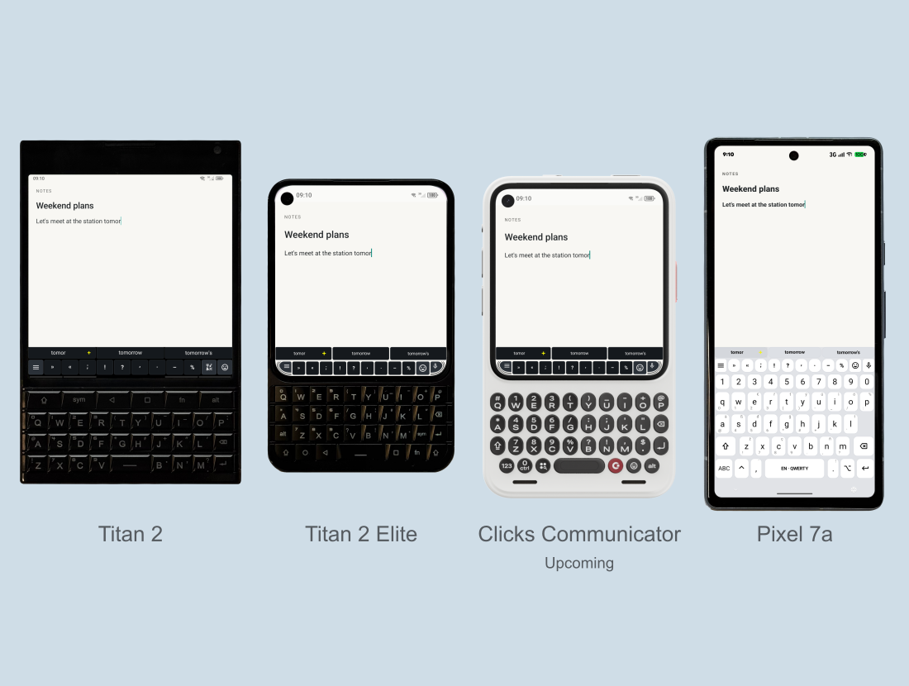
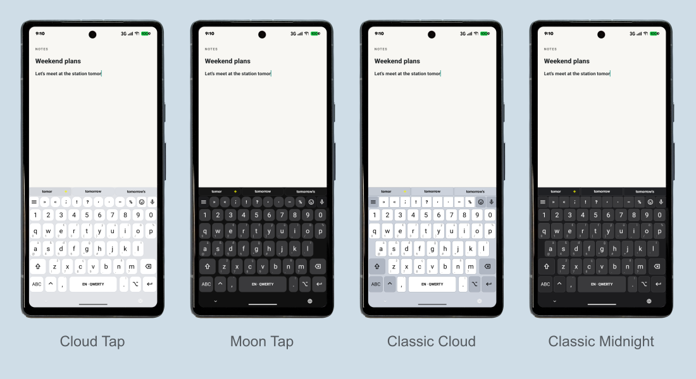

# Plektra device showcase

Advanced (hardware) keyboard control on Android. Free software under GPLv3.

Explore 21 presentations in the [Stable gallery](#stable-gallery) or [Nightly gallery](#nightly-gallery).

The galleries use real Titan 2, Titan 2 Elite and Pixel 7a captures from October 2026. Both palettes show Nightly debug UI; native screenshot colors and contents are preserved. The Notes editor contains synthetic example text. Processed photographs frame the actual app captures. The device comparison also includes an upcoming Clicks Communicator preview, using an official frontal product render and the same original screen composition as the Titan 2 Elite.

## Reproduce the images

Install Node.js 20.9 or later, ImageMagick (`magick`) and librsvg (`rsvg-convert`). Then run from the repository root:

```sh
npm --prefix docs/showcase ci
npm --prefix docs/showcase run render
npm --prefix docs/showcase run verify
```

`render` creates all 21 images for both channels in landscape and portrait formats, plus SVGs and contact sheets. Visual-only PNGs are embedded in the READMEs; landscape PNGs remain the complete presentation slides. Portrait images, SVGs, crops, composed frames and contact sheets are ignored build outputs. Rendering does not create PDFs.

The renderer uses the recorded inputs under `raw/`, processed frames and display geometry under `frames/`, the presentation catalog under `sources/`, and branding from `../branding/`. It does not connect to a device. Private capture-session backups and original full photographs stay local.

The verifier checks all 84 slide dimensions and channel backgrounds, plus 42 visual-only exports, checks native transparent exports and retained foreground colors, and checks that the Titan 2 Elite frame retains the captured bottom LEDs. These checks validate the presentation, not device behavior.

Capture versions and source hashes are in [provenance.json](provenance.json). Input and published-image hashes are in [checksums.json](checksums.json). The processed frames retain photographic hardware and key lettering; no generated hardware or reconstructed key legends are used.

## Stable gallery

### Advanced (hardware) keyboard control on Android

Free software under GPLv3, with source code you can inspect, modify and share.



### Modular toolbar configuration

Configure suggestions, character variations and menu buttons independently.


### Adjustable interface density

Choose a full bar, compact controls, a modifier LED strip or a hidden bar.


### Dual profiles: Normal and Slim

Configure Normal and Slim independently, then switch between the two profiles.


### Flexible toolbar layouts

Place suggestions and actions in a shared row or arrange them in stacked rows.


### Predictive text and completions

Complete words from suggestions as you type. Dictionaries and locally learned next words are supported.


### Contextual character variations

Select accented letters and symbols from the variations for the current character.


### Expandable text snippets & templates

Save reusable text such as addresses, email addresses and dates. Find snippets with a short prefix.


### Text shortcut expansion

Expand a snippet shortcut into its saved text.


### Direct SYM layer mapping

Open SYM pages and enter symbols using the corresponding physical keys.


### Integrated, low-profile emoji picker

Browse and insert emoji from the keyboard.


### Integrated clipboard manager

Browse clipboard history and insert a saved entry.


### Keyboard text selection

Select text using physical keyboard controls.


### Live modifier state indicators

See active and locked modifiers in the keyboard bar or Android status bar.


### Nine built-in interface themes

Choose from nine built-in keyboard bar themes.


### Standalone software keyboard mode

Use the software keyboard on phones without physical keys, with suggestions, symbols and snippets.



### Native QWERTY, AZERTY and QWERTZ support

Select QWERTY, AZERTY or QWERTZ, including German umlauts.


### High-contrast mode for improved visibility

Use a high-contrast theme with clear key outlines and distinct modifier indicators.


### Long-press secondary characters

Long-press a software key to select its secondary characters.


### Ortholinear and staggered key geometries

Choose ortholinear or staggered rows for the software keyboard.


### Terminal-style Ctrl navigation and selection

Use Ctrl shortcuts to move the cursor, select text, copy and paste.


## Nightly gallery

### Advanced (hardware) keyboard control on Android

Free software under GPLv3, with source code you can inspect, modify and share.



### Modular toolbar configuration

Configure suggestions, character variations and menu buttons independently.


### Adjustable interface density

Choose a full bar, compact controls, a modifier LED strip or a hidden bar.


### Dual profiles: Normal and Slim

Configure Normal and Slim independently, then switch between the two profiles.


### Flexible toolbar layouts

Place suggestions and actions in a shared row or arrange them in stacked rows.


### Predictive text and completions

Complete words from suggestions as you type. Dictionaries and locally learned next words are supported.


### Contextual character variations

Select accented letters and symbols from the variations for the current character.


### Expandable text snippets & templates

Save reusable text such as addresses, email addresses and dates. Find snippets with a short prefix.


### Text shortcut expansion

Expand a snippet shortcut into its saved text.


### Direct SYM layer mapping

Open SYM pages and enter symbols using the corresponding physical keys.


### Integrated, low-profile emoji picker

Browse and insert emoji from the keyboard.


### Integrated clipboard manager

Browse clipboard history and insert a saved entry.


### Keyboard text selection

Select text using physical keyboard controls.


### Live modifier state indicators

See active and locked modifiers in the keyboard bar or Android status bar.


### Nine built-in interface themes

Choose from nine built-in keyboard bar themes.


### Standalone software keyboard mode

Use the software keyboard on phones without physical keys, with suggestions, symbols and snippets.



### Native QWERTY, AZERTY and QWERTZ support

Select QWERTY, AZERTY or QWERTZ, including German umlauts.


### High-contrast mode for improved visibility

Use a high-contrast theme with clear key outlines and distinct modifier indicators.


### Long-press secondary characters

Long-press a software key to select its secondary characters.


### Ortholinear and staggered key geometries

Choose ortholinear or staggered rows for the software keyboard.


### Terminal-style Ctrl navigation and selection

Use Ctrl shortcuts to move the cursor, select text, copy and paste.


The software keyboard gallery uses four Pixel 7a captures in one row: Cloud Tap, Moon Tap, Classic Cloud and Classic Midnight, each with its own preset geometry and the default QWERTY layout. All four use the same native plain Notes host; only the ADB notification icon was painted over in the status bar. The device comparison keeps the physical Titan 2 Elite keyboard from its native alpha export, preserves its original status bar, and places these over the plain Notes backdrop; its LED geometry and pixels are preserved. Capture sources and this composition are recorded in [provenance.json](provenance.json).

## Capture new screenshots

`scripts/capture-showcase.sh` captures screenshots and native transparent keyboard exports on an emulator or a physical device. It uses the Nightly debug build, which must be installed on the device first.

1. Install the debug build on the device. Pass the device serial with `--device`. The script does not read `ANDROID_SERIAL`.

   ```sh
   scripts/build-nightly-debug.sh 26.10 --install --device <serial>
   ```

2. Run the capture for one device profile. Use `titan-2-elite`, `titan-2` or `pixel-7a`.

   ```sh
   scripts/capture-showcase.sh --serial <serial> --device titan-2-elite
   ```

   To capture only some states, add `--only r6-full,r5-slim`. Every scene runs in the app's Markdown notes editor. The script adds the scene text as one synthetic note beside the existing notes and removes it again at the end, together with the changed settings.

**Emulator.** Start the Android Virtual Device and wait until it has finished booting. The serial is usually `emulator-5554`. The display must have no size override, so run `adb shell wm size reset` first if the script reports a mismatch. The Titan 2 Elite profile expects a 1080 by 1200 display.

**Physical device.** Enable USB debugging, connect the device and check that `adb devices` lists its serial. Keep the screen unlocked and awake during the run.

The script changes some device settings while it runs. It turns on the system demo mode (clock 09:10, full battery, no notifications), changes the Plektra keyboard and notes settings for each scene, and sets the input method to Plektra Nightly if needed. It puts all of these back when it exits, including after an error or Ctrl-C. Check the device afterwards if a run is interrupted.

Each run writes to `build/showcase-capture/<device>/<timestamp>/`. The folder holds a screenshot per state, `*-ime.png` native alpha exports and `*-ime.json` dimensions/position metadata for visible keyboards, plus a `manifest.json` with the device, serial, app version, time and SHA-256 hash of every file. Captures are never written to `raw/` automatically. Review screenshots and transparent exports against the existing references, then copy the approved files into `raw/<device>/` by hand. The renderer uses native alpha exports when available; screenshots supply the device frames.

The scene table is [capture/scenes.json](capture/scenes.json). Each entry lists the device, the keyboard settings, the theme, the typed text and key events, and the crop. States with `"manual": true` are skipped by the script; the `instruction` field says how to capture them by hand. New gallery scenes explicitly select software keyboard mode. The Titan 2 Elite baseline selects its physical keyboard profile even on an emulator. Record the emulator profile or physical device in provenance when promoting captures.

## Transparent export in Debug builds

Advanced settings contains **Transparent keyboard export** and **Share PNG**. Enable export, display the keyboard with synthetic text, then return to settings to share the PNG. The setting switches off after one export. The PNG can contain visible suggestions or clipboard text.

The Debug-only shell receiver can also export the current visible IME without changing preferences:

```sh
adb -s <serial> shell am broadcast -n rocks.pkb.plektra.nightly/rocks.pkb.plektra.ShowcaseReceiver --ez exportTransparent true
adb -s <serial> exec-out run-as rocks.pkb.plektra.nightly cat cache/debug-reports/keyboard-transparent.png > keyboard-transparent.png
```

Exports draw the native keyboard children, including both LED rails, on an ARGB bitmap. Host content, window backgrounds and structural row/chrome background fills are omitted. Key surfaces, icons, gaps and antialiasing keep their native colors and alpha. Release builds contain no export control or receiver.

## Device comparison scale

The opening device comparison uses one physical width scale: Titan 2 88.7 mm, Titan 2 Elite 75 mm, Clicks Communicator 78.6 mm and Pixel 7a 72.9 mm. Manufacturer dimensions and source links are recorded in [device-dimensions.json](sources/device-dimensions.json). Transparent photograph margins are excluded when measuring the frame widths; each photograph keeps its aspect ratio.

The upper edge of each keyboard bar is measured in its capture and mapped into its device frame. These edges share one horizontal reference. Device labels share one baseline, with a 16 px gap below the lowest device silhouette.
